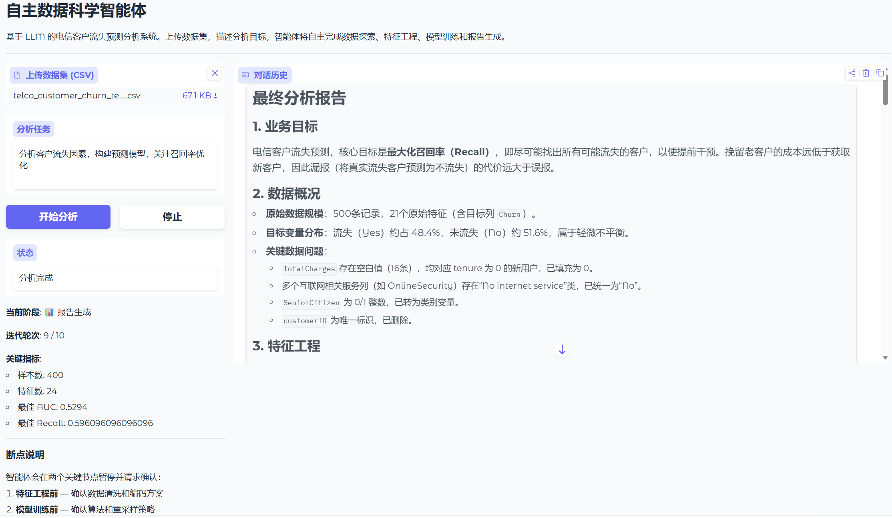

# Autonomous Data Science Agent

A lightweight LLM-powered autonomous data science system tailored for telecom customer churn prediction. Built on the Dual-Track ReAct architecture, it combines LangGraph state machines with a stateful Jupyter Kernel sandbox to autonomously perform data exploration, feature engineering, model training, and business insight generation — while pausing at critical checkpoints for Human-in-the-Loop confirmation.



---

## Table of Contents

- [Key Features](#key-features)
- [System Architecture](#system-architecture)
- [Tech Stack](#tech-stack)
- [Quick Start](#quick-start)
- [Project Structure](#project-structure)
- [Checkpoint Mechanism](#checkpoint-mechanism)
- [Deliverables](#deliverables)
- [Environment Variables](#environment-variables)
- [License](#license)

---

## Key Features

- **Dual-Track ReAct Architecture**: Separates the Semantic Chat Track from the Runtime State Track to prevent context explosion during long-running data analysis sessions.
- **Stateful Code Execution Sandbox**: Powered by Jupyter Kernel with persistent variable and model-object memory across turns; natively captures stdout, stderr, charts, and images.
- **Critical-Node Checkpoints**: Automatically suspends before feature engineering and model training to present proposals and accept user feedback before execution.
- **Observation Compression Middleware**: DataFrame outputs are auto-summarized to shape/dtypes; tracebacks are truncated to key lines, preventing LLM context-window overflow.
- **Streaming Gradio Frontend**: Real-time conversation history, execution status, progress panel (phase / iteration / key metrics), and checkpoint confirmation panel.
- **Auto-Export Code History**: Upon completion, the system automatically generates a `.py` execution script and a `.ipynb` Notebook for reproducibility.

---

## System Architecture

```text
┌─────────────────────────────────────────────────────────────┐
│                       Frontend (Gradio)                     │
│  - Dataset upload  - Natural-language task  - Checkpoint    │
│    confirmation (Human-in-the-Loop)                         │
└───────────────────────┬───────────────▲─────────────────────┘
                        │ Command/Intervene   │ Stream thoughts/charts
┌───────────────────────▼───────────────┴─────────────────────┐
│                    Agent Core (LangGraph)                   │
│ ┌──────────────────────────┐   ┌──────────────────────────┐ │
│ │  Semantic Chat Track     │   │  Runtime State Track     │ │
│ │ (Filtered Observations,  │   │ (Data Schema, Best Metrics)│ │
│ │  Reasoning)              │   │                          │ │
│ └──────────────────────────┘   └──────────────────────────┘ │
│          - State Graph Routing & Breakpoint Management      │
└───────────────────────┬───────────────▲─────────────────────┘
                        │ Generate code   │ Execution result / exception / image refs
┌───────────────────────▼───────────────┴─────────────────────┐
│              Stateful Code Sandbox (Jupyter Kernel)         │
│   - Persistent memory space (variables, models reused)      │
│   - Auto-capture stdout, stderr, display_data (base64 img)  │
└─────────────────────────────────────────────────────────────┘
```

---

## Tech Stack

| Module | Technology |
|--------|------------|
| Frontend | Gradio |
| Agent Framework | LangGraph (1.x) |
| LLM API | DeepSeek (OpenAI-compatible SDK) |
| Code Sandbox | Jupyter Kernel (jupyter_client) |
| Data Processing | Pandas, Scikit-learn, XGBoost, Imbalanced-learn |
| Visualization | Matplotlib, Seaborn |
| Environment | Docker |

---

## Quick Start

### 1. Clone the repository

```bash
git clone https://github.com/1Zonghao/LLM-based-Telecom-Customer-Churn-Prediction-and-Analysis-System.git
cd LLM-based-Telecom-Customer-Churn-Prediction-and-Analysis-System
```

### 2. Install dependencies

```bash
pip install -r requirements.txt
```

### 3. Configure API Key

Create a `.env` file in the project root:

```env
LLM_API_KEY=sk-your-api-key
LLM_BASE_URL=https://api.deepseek.com
LLM_MODEL=deepseek-v4-pro
```

> **Note**: `.env` is already excluded by `.gitignore` and will never be committed.

### 4. Launch the service

```bash
python src/main.py
```

The browser will automatically open `http://localhost:7860`, featuring:
- **Left panel**: Dataset upload, task description, start/stop buttons, real-time progress
- **Right panel**: Streaming chat history and checkpoint confirmation panel (with user-feedback textbox)

### 5. Run tests

```bash
# Phase 1: Sandbox kernel smoke tests
python tests/test_sandbox.py

# Phase 2: LangGraph agent integration tests
python src/main_agent.py

# Phase 4: Robustness & self-repair tests
python tests/test_robustness.py
```

---

## Project Structure

```text
.
├── CLAUDE.md                 # Technical design document
├── README.md                 # Chinese README
├── README-EN.md              # English README
├── requirements.txt          # Python dependencies
├── .env                      # Environment variables (local only)
├── .gitignore
├── data/
│   └── WA_Fn-UseC_-Telco-Customer-Churn.csv   # Sample dataset
├── docker/
│   └── Dockerfile            # Headless Jupyter sandbox image
├── outputs/                  # Auto-exported code history (.py / .ipynb)
├── src/
│   ├── main.py               # Gradio frontend entry point
│   ├── main_agent.py         # Phase 2 integration tests
│   ├── agent/
│   │   ├── state.py          # AgentState dual-track definition
│   │   ├── graph.py          # LangGraph compilation & streaming
│   │   ├── nodes.py          # reasoning / action / checkpoint nodes
│   │   ├── prompts.py        # SYSTEM_PROMPT / CONTINUE_PROMPT
│   │   └── llm_client.py     # OpenAI-compatible LLM client
│   ├── sandbox/
│   │   ├── kernel_manager.py # Jupyter Kernel stateful manager
│   │   └── compressor.py     # Execution-result compression middleware
│   └── ui/
│       └── app.py            # Gradio UI & checkpoint interaction logic
└── tests/
    ├── test_sandbox.py       # Phase 1 sandbox smoke tests
    └── test_robustness.py    # Phase 4 boundary & self-repair tests
```

---

## Checkpoint Mechanism

The system auto-suspends at two critical nodes via `interrupt_before`, waiting for user confirmation:

1. **Before Feature Engineering (`checkpoint_fe`)**
   - The agent presents an EDA summary and a feature-processing proposal (cleaning strategy, encoding scheme, resampling method).
   - Users can add requirements in the feedback box (e.g., "Use SMOTE instead of class_weight", "Apply log transform to TotalCharges").
   - After clicking **Confirm**, the feedback is injected into the subsequent conversation, and the agent adjusts its plan accordingly.

2. **Before Model Training (`checkpoint_model`)**
   - The agent confirms the algorithm list and resampling strategy.
   - Users can revise model selection or evaluation metrics.

Clicking **Skip subsequent confirmations / Auto-complete** sets `auto_confirm=True`, causing all future checkpoints to auto-approve without further panels.

---

## Deliverables

After analysis completes, the system automatically generates two files in the `outputs/` directory:

- **`analysis_YYYYMMDD_HHMMSS.py`**: Full code execution history as an annotated Python script.
- **`analysis_YYYYMMDD_HHMMSS.ipynb`**: Standard Jupyter Notebook with Markdown task descriptions and executable code cells.

---

## Environment Variables

| Variable | Required | Default | Description |
|----------|----------|---------|-------------|
| `LLM_API_KEY` | Yes | — | DeepSeek (or other OpenAI-compatible provider) API key |
| `LLM_BASE_URL` | No | `https://api.deepseek.com` | API base URL |
| `LLM_MODEL` | No | `deepseek-v4-pro` | Model name |

---

## License

MIT License © 2025 1Zonghao
